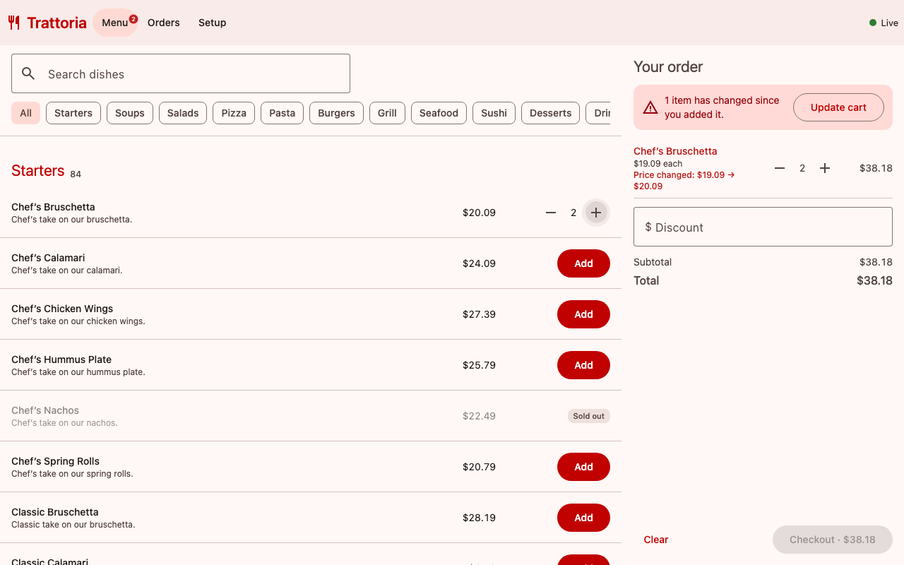

# Restaurant Ordering — real-time prototype

Angular 22 + NgRx client and a NestJS server with PostgreSQL, Redis and Socket.IO.
Menu, prices and availability change live; orders are placed exactly once and
their statuses update in real time.



## How to run

The only requirement is **Docker** (Docker Desktop or Docker Engine with Compose v2).

```bash
docker compose up --build
```

Open **http://localhost:8080**. The first build takes a few minutes; later starts take seconds.

| Page | URL | What to try |
|---|---|---|
| Menu | `/menu` | Add items, use the quantity steppers, add an open-price item ("Catch of the Day", "Steak by Weight"…), set a discount, check out |
| Orders | `/orders` | Statuses move `New → Accepted → Cooking → Ready → Completed` every 8 s |
| Setup | `/setup` | Toggle availability / open price, edit prices, add or delete items and categories |

Open Setup and Menu in two tabs (or two browsers) to see changes appear live.

```bash
docker compose down        # stop
docker compose down -v     # stop and wipe the database (the demo menu is re-seeded on next start)
```

What starts:

```
            host :8080
                │
   ┌────────────┴─────────────┐  network "frontend"
   │ app (NestJS)             │
   │  • REST API  /api/*      │
   │  • Socket.IO /socket.io  │
   │  • Angular build (static)│
   └──────┬───────────┬───────┘  network "backend" (internal: no host / internet access)
          │           │
   ┌──────┴─────┐ ┌───┴──────┐
   │ PostgreSQL │ │ Redis 7  │
   │ 16         │ │          │
   └────────────┘ └──────────┘
```

The app waits for healthy Postgres and Redis (`depends_on: service_healthy`), applies
the schema and seeds a demo menu of ~1000 items on first start.

### Development without Docker (optional)

Node.js ≥ 22:

```bash
npm install   # installs root, server and client dependencies
npm start     # server on :3000 (in-memory storage) + Angular dev server on :4200
```

Without `DATABASE_URL` / `REDIS_URL` the server uses in-memory implementations of the
same interfaces, so no database is needed for development or tests.

### Checks

```bash
npm run check   # lint + all tests + production builds (client and server)
```

- server: unit tests (pricing rules) and e2e tests through HTTP (idempotency, concurrent
  double submit, menu-changed conflicts, validation, status updates) — Vitest + Supertest
- client: reducers, selectors and effects (double click, retries with the same key,
  stale real-time events, optimistic rollback) — Vitest
- lint: angular-eslint for the client, oxlint (type-aware) for the server
- TypeScript runs in strict mode in both projects

## Key decisions and trade-offs

**Server: NestJS + PostgreSQL + Redis, behind storage ports.**
Services depend on abstract `MenuRepository`, `OrdersRepository`, `IdempotencyStore`
and `EventBus` (`server/src/domain/ports.ts`). Docker wires the Postgres/Redis
implementations; tests and `npm start` use in-memory ones. *Trade-off:* two implementations
to keep in sync, in exchange for zero-dependency tests and a fast dev loop.

**An order is never placed twice.** Four independent layers:
1. the client generates an `Idempotency-Key` per checkout attempt and keeps it (also in
   `localStorage`) until the order succeeds or the cart changes;
2. NgRx `exhaustMap` ignores repeated clicks while the request is in flight, and the
   button is disabled;
3. the server takes a Redis `SET NX` lock per key: concurrent duplicates get `409
   ORDER_IN_PROGRESS`, later duplicates get the original order back (`200` +
   `Idempotent-Replayed`);
4. a `UNIQUE (idempotency_key)` constraint in Postgres is the last line of defence.

Because of this, network errors and 502–504 are retried automatically with the same key.

**The user is told about menu changes before confirming.** Cart lines remember the price
the user saw. A selector compares every line with the live menu, so a price change,
sold-out or removed item shows up in the cart and in the open confirmation dialog at once,
and blocks checkout until the user presses "Update cart". The server repeats the same check
(`server/src/orders/pricing.ts`) and answers `409 MENU_CHANGED` with the current state of
every changed item, which the client applies right away. The server always recalculates
totals itself, so the client cannot set prices.

**Real time: Socket.IO + Redis Pub/Sub.** Socket.IO brings reconnection with backoff,
heartbeats and a long-polling fallback for networks that block WebSockets. Each API
instance subscribes to Redis topics (`menu.changes.v1`, `order.lifecycle.v1`), so the app
can run as several instances. *Trade-off:* Pub/Sub has no replay. On every reconnect the
client re-fetches menu and orders snapshots instead, and entity `version` numbers make sure
a late snapshot or an out-of-order event never overwrites newer data.

**State: NgRx** (store, effects, entity) with `selectSignal`, `OnPush` components and
zoneless change detection. Admin toggles are optimistic and roll back with a message
if the server refuses them.

**Speed on low-end devices and slow networks.**
- Lazy-loaded routes; Socket.IO client loaded after first render; initial JS is ~146 kB
  gzipped. The page shell is painted from `index.html` before Angular boots.
- The ~1000-item menu uses CDK virtual scrolling with fixed 72 px rows (headers included),
  so only about 20 rows exist in the DOM.
- Skeletons with the final sizes and fixed-height rows keep the layout from jumping
  while data loads. The icon font is a subset of only the 9 glyphs the app uses.
- gzip compression on the server (the menu payload goes from 237 kB to 38 kB).
- All money is stored and computed as integer cents.

**Reliability.** Errors are turned into human-readable messages (`toApiError`).
GET requests retry with backoff, and failed page loads show a "Try again" button. A banner
explains when live updates are paused. The cart survives reloads (`localStorage`, guarded
for private mode). On the server, Postgres connection retries, a non-fatal broadcast after
the order is saved, and Docker health checks with `restart: unless-stopped`.

## What I deliberately simplified

- **No authentication or roles.** Setup is open to everyone; in reality it is an admin area.
- **Kitchen simulator.** `OrderStatusSimulator` moves statuses forward on a timer instead
  of staff doing it. It uses a single atomic `UPDATE`, so it is safe with several instances,
  but it is not a real workflow (no cancellation, no rejection).
- **Schema in code** (`CREATE TABLE IF NOT EXISTS` under an advisory lock) instead of
  versioned migrations.
- **Last write wins** for concurrent edits by two admins (versions are used only to order
  real-time events, not for optimistic locking of edits).
- **Discount** is a plain fixed amount entered by the user and only checked against the
  subtotal on the server: no promo codes, no limits.
- **Shared types are duplicated** (`server/src/domain/models.ts` ↔ `client/src/app/core/models.ts`)
  instead of a shared package or OpenAPI-generated client.
- **Payments, taxes, currencies, i18n** are out of scope; prices are USD.
- Orders list returns the last 200 orders without pagination.

## What production would need

- Auth (staff/admin roles, guest sessions), CSRF/CORS tightened to known origins, rate limits per user.
- Versioned migrations (e.g. node-pg-migrate / Prisma Migrate), backups, managed Postgres & Redis.
- Transactional outbox (or Kafka/NATS JetStream) so events cannot be lost between DB commit and publish; event replay by sequence number instead of full snapshots.
- Optimistic locking (`If-Match` / version) for admin edits; audit log of menu changes.
- Real order workflow (kitchen screen, cancellation, payment provider with authorize/capture).
- Pagination / incremental sync for menu and orders; HTTP caching (ETag) for the menu snapshot.
- Shared API contract (OpenAPI or a shared TS package) and contract tests.
- Observability: structured logs, metrics, tracing, error reporting (Sentry), alerting.
- Browser E2E tests in CI (Playwright), Lighthouse budgets, accessibility audit.
- CDN for static assets, HTTP/2, a service worker for offline shell and retries.
- Horizontal scaling of the API (it already works with several instances thanks to Redis), Socket.IO sticky sessions at the load balancer.

## Project structure

```
├── docker-compose.yml     Postgres + Redis + app, isolated backend network
├── Dockerfile             multi-stage: build client, build server, slim runtime image
├── package.json           root scripts: start / test / lint / build / check
├── server/                NestJS
│   ├── src/domain/        models, ports (interfaces)
│   ├── src/infrastructure/ postgres/, redis/, memory/ implementations, seed
│   ├── src/menu/          categories & items API
│   ├── src/orders/        pricing rules, idempotent checkout, status simulator
│   ├── src/realtime/      Socket.IO gateway
│   └── test/              e2e tests
└── client/                Angular
    └── src/app/
        ├── core/          API client, models, error mapping
        ├── store/         NgRx: menu, cart, orders, connection (+ specs)
        ├── features/      menu (list, cart, checkout), orders, setup
        └── shared/        pipes, dialogs, quantity stepper
```

### API

| Method | Path | Notes |
|---|---|---|
| GET | `/api/menu` | `{ categories, items }` |
| POST / PATCH / DELETE | `/api/categories[/:id]` | deleting requires an empty category |
| POST / PATCH / DELETE | `/api/items[/:id]` | PATCH is partial; price required unless `openPrice` |
| GET | `/api/orders` | latest 200 |
| POST | `/api/orders` | header `Idempotency-Key`; `409 MENU_CHANGED` with `issues[]` |
| WS | `/socket.io` | events `menu` and `order` |


