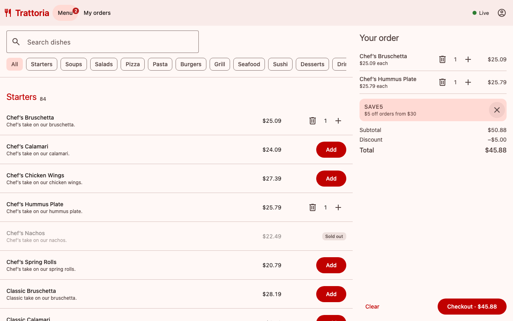
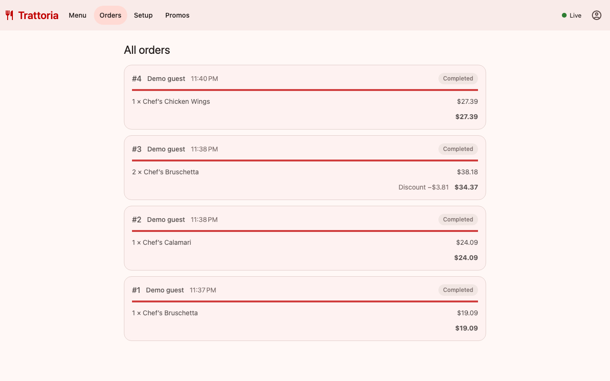
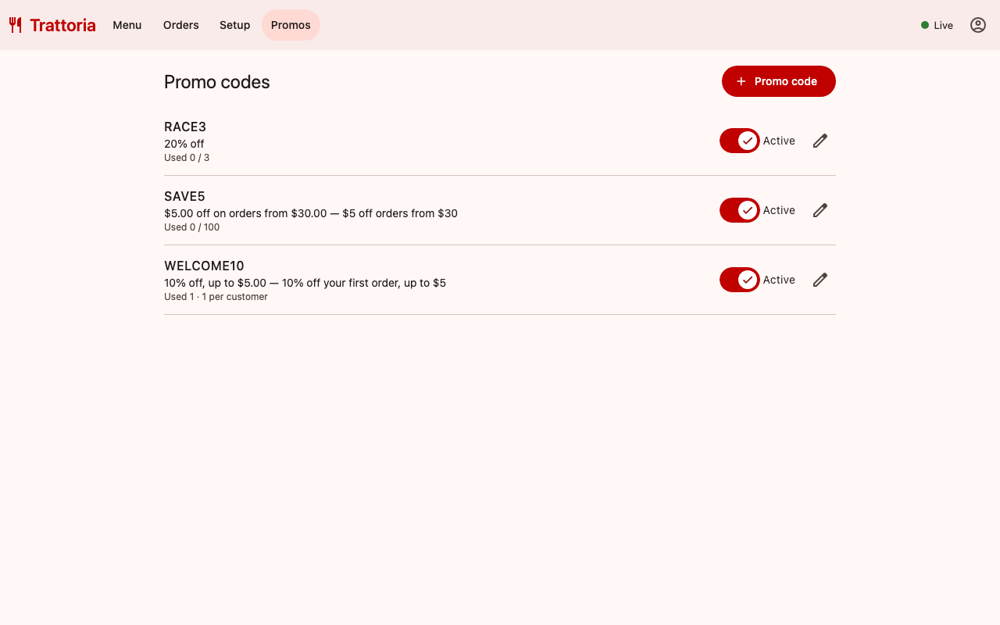
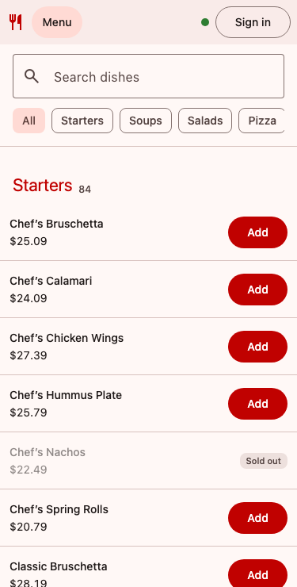

# Restaurant Ordering — real-time prototype

Angular 22 + NgRx client, NestJS API, PostgreSQL, Redis, Socket.IO, behind a Caddy edge.
Menu, prices and availability change live; orders are placed exactly once; order statuses
update in real time; promo codes, authentication and admin tools are included.



## How to run

The only requirement is **Docker** (Docker Desktop or Docker Engine with Compose v2).

```bash
docker compose up --build
```

Open **http://localhost:8080** (or **https://localhost:8443** for HTTP/2 + HTTP/3; the
certificate comes from Caddy's local CA, so the browser asks to accept it once).
The first build takes a few minutes.

| Account | Email | Password |
|---|---|---|
| Customer | `guest@trattoria.local` | `guest12345` |
| Admin | `admin@trattoria.local` | `admin12345` |

New customers can register on the sign-in page. Demo promo codes: `WELCOME10` (10% off,
up to $5, once per customer) and `SAVE5` ($5 off orders from $30).

| Page | Who | What to try |
|---|---|---|
| `/menu` | everyone | Browse ~1000 items, search, add to cart, open-price items, promo code, checkout (sign-in required) |
| `/orders` | signed in | Own orders (admins: all, with customer names); statuses move every 8 s; older pages load on demand |
| `/setup` | admin | Toggle availability / open price, edit, add, delete; edits by two admins at once are detected |
| `/promos` | admin | Create and edit promo codes, switch them on and off |
| `/api/docs` | everyone | OpenAPI (Swagger UI) generated from the shared contract |

Open the menu as a customer and Setup as an admin in two browsers to see changes appear live.

```bash
docker compose down        # stop
docker compose down -v     # stop and wipe data (the demo menu and accounts are re-created)
```

### Observability stack (optional)

```bash
docker compose -f docker-compose.yml -f docker-compose.observability.yml up --build
```

Grafana http://localhost:3001 (dashboard "Trattoria API") · Prometheus http://localhost:9090 ·
Alertmanager http://localhost:9093 · Jaeger http://localhost:16686 (traces of every request,
including SQL and Redis calls). Error reporting goes to Sentry when `SENTRY_DSN` (server) and
`SENTRY_DSN_CLIENT` (browser) are set.

### Development without Docker (optional)

Node.js ≥ 22:

```bash
npm install   # installs the shared contract package, the server and the client
npm start     # API on :3000 with in-memory storage + Angular dev server on :4200
```

Without `DATABASE_URL` / `REDIS_URL` the API uses in-memory implementations of the same
interfaces, so no database is needed for development or tests.

### Checks

```bash
npm run check   # lint + all tests + production builds
```

- **server** (Vitest + Supertest): pricing and promo rules; e2e for auth and roles, idempotent
  and concurrent checkout, menu changes during checkout, optimistic locking (5 simultaneous
  edits → exactly 1 wins), promo limits under concurrency, pagination, the event log and replay;
  **provider contract tests** (every route documented; real responses validate against the schemas)
- **client** (Vitest): reducers, selectors, effects (double click, retries with the same key,
  replay after reconnect, per-item edit serialisation), guards, interceptor, error reporter;
  **consumer contract test** (every request the app makes exists in the contract with a valid body)
- **lint**: angular-eslint + typescript-eslint (explicit return types, no enums, no arrow-function
  methods), oxlint (type-aware) for the server; TypeScript `strict` everywhere, `strictTemplates`

## Architecture

```
 browser ──HTTP/1.1 :8080 · HTTP/2+3 :8443──► edge (Caddy)
   │  service worker: offline shell,          ├─ static app: immutable caching, zstd/gzip, CSP
   │  cached menu                              ├─ /api/*       → round-robin ┐
   │                                           └─ /socket.io/* → sticky      ┤
   │                                                                          ▼
   │                                       app (NestJS) × 2 replicas ── /metrics :9464 (internal)
   │                                         REST · Socket.IO · auth · outbox relay (one leader)
   │                                             │                    │
   │                                     PostgreSQL 16          Redis 7
   │                                     data + outbox          pub/sub fan-out, idempotency
   │                                     (event log)            locks, shared rate limits
   └──────────── same types ◄── @trattoria/contracts (zod schemas → TS types + OpenAPI)
```

Databases live on an internal Docker network (unreachable from the host); only the edge is
published.

## Key decisions and trade-offs

**One contract package.** `shared/` (`@trattoria/contracts`) holds zod schemas. From them come
the TypeScript types of both apps, the OpenAPI document (`/api/openapi.json`) and the runtime
checks in contract tests. The client imports types only, so zod is not in the browser bundle.
*Trade-off:* a build step for the package, and DTO validation on the server still uses
class-validator (Nest-native); contract tests keep the two in line.

**Authentication: JWT in an httpOnly, `SameSite=Strict` cookie.** Scripts cannot read the token
(XSS), the browser does not send it cross-site (CSRF), and the Socket.IO handshake gets it
automatically. Passwords use scrypt from `node:crypto`. A global guard closes every route unless
marked `@Public()`; `@Roles('admin')` protects menu and promo management. Customers only see their
own orders, over REST, replay and WebSocket rooms alike. Idempotency keys are scoped per user.
*Trade-off:* stateless tokens cannot be revoked before they expire (12 h); a role change applies
at the next sign-in.

**An order is never placed twice.** Client idempotency key (kept until success or a cart change,
persisted across reloads) + `exhaustMap` + Redis `SET NX` lock + a unique index in Postgres.
Network errors are retried with the same key; an order started offline is sent when the browser
is back online.

**The user is told about menu changes before confirming.** Cart lines remember the price they
were added at and are checked live against the menu; the confirmation dialog blocks on any
change. The server repeats the check and returns `409 MENU_CHANGED` with the current items.
The server computes all prices and discounts itself.

**Promo codes instead of a typed discount.** Percent (optionally capped) or fixed amount, minimum
order, total and per-customer limits, start/end dates, on/off. `computeDiscount` lives in the
shared package, so the cart shows exactly what will be charged. Redemption happens in the order's
transaction under `SELECT … FOR UPDATE`, so limits hold under concurrency (8 parallel orders on a
code limited to 3 → exactly 3 succeed).

**Optimistic locking for admin edits.** Writes send `If-Match: "<version>"`; the version check
is part of the `UPDATE`, so of two concurrent edits one wins and the other gets `412` with the
current state, which the UI shows. Quick repeated toggles of one item are sent one by one with the
latest version, so an admin never conflicts with themselves.

**Transactional outbox and replay by sequence number.** Every change writes its event to an
`outbox` table in the same transaction; appends are serialised so `seq` order equals commit order.
One relay (leader elected with a Postgres advisory lock, woken by `LISTEN/NOTIFY`) publishes to
Redis, every replica fans out to its sockets. Snapshots carry their `seq`; after a reconnect the
client calls `GET /api/events?after=<seq>` and applies only what it missed (full reload only if the
log was pruned). *Trade-off:* serialised appends cap write throughput (fine for a restaurant);
delivery is at-least-once, de-duplicated by `seq` and entity versions.

**Real-time transport.** Socket.IO over WebSocket first (one connection, any replica), long-polling
as a fallback for networks that block WebSockets; only that fallback needs the sticky cookie on
`/socket.io`. The REST API is stateless and round-robin. The client reconnects on the browser
`online` event and shows connection state; heartbeats detect dead connections in ~15 s.

**Performance.** Lazy routes; Socket.IO and Sentry loaded on demand; initial JS ~155 kB gzipped.
CDK virtual scrolling with fixed 72 px rows for the 1000-item menu; skeletons with final sizes;
`OnPush` + signals, zoneless change detection. The edge serves hashed bundles with
`immutable` one-year caching (CDN-ready), compresses with zstd/gzip and speaks HTTP/2 and HTTP/3.
Pagination for orders is keyset-based, so live orders do not shift pages.

**Reliability.** Human-readable errors everywhere, retries with backoff for reads, "Try again"
on failed loads, connection banner, cart persisted locally. Service worker: the app shell and the
last menu work offline; users are told when a new version is ready. Two API replicas; stopping one
keeps the app working (live updates continue, the outbox relay fails over). Rate limits are shared
in Redis. Health checks and restarts in Compose.

**Observability.** pino JSON logs with request id, user id and trace id; Prometheus metrics (HTTP
RED by route, orders, revenue, checkout rejections by reason, version conflicts, sign-ins, outbox
backlog and age, socket connections) on an internal port; OpenTelemetry traces; Sentry for 5xx and
browser errors; alert rules for instance down, error rate, latency, a stuck outbox, rejection and
failed-login spikes.

## What I deliberately simplified

- **Payments, taxes, currencies and i18n** are out of scope: totals are what the customer would
  pay, in USD, in English. In a real system the order would be authorised with a payment provider
  (authorize at checkout, capture on completion, refunds), with tax rules per item and locale
  formatting.
- **Kitchen simulator.** Statuses move forward on a timer instead of staff actions; there is no
  cancellation or rejection flow.
- **Schema in code** (`CREATE … IF NOT EXISTS` / `ALTER … ADD COLUMN IF NOT EXISTS` under an
  advisory lock) instead of versioned migrations.
- **Demo secrets and accounts** in `docker-compose.yml`; a local CA certificate for HTTPS; Caddy
  stands in for both the CDN and the load balancer.
- **Sessions** are stateless JWTs without refresh tokens or revocation; no password reset or e-mail
  verification.
- **Promo codes** cannot be deleted (only switched off) and do not stack.

## What production would need

- Payment provider integration, taxes, multi-currency and i18n (see above).
- Managed, highly available Postgres and Redis; backups; versioned migrations; secrets from a
  vault; real certificates; a real CDN in front of the static files.
- Session revocation (short-lived access token + refresh token or a server-side session list),
  password reset, MFA for admins, audit log of menu and promo changes.
- Kafka or NATS JetStream instead of Redis Pub/Sub when other services need the event stream;
  a dead-letter path for events that cannot be published.
- Kubernetes (or similar) with autoscaling, rolling deploys and pod disruption budgets.
- Load and soak tests, browser E2E tests in CI, Lighthouse budgets, accessibility audit.
- Alert routing (Slack / PagerDuty) and on-call runbooks for the alerts provided.

## Project structure

```
├── docker-compose.yml                 Postgres, Redis, 2 API replicas, edge
├── docker-compose.observability.yml   Prometheus, Alertmanager, Grafana, Jaeger
├── Dockerfile                         targets: app (API), edge (Caddy + static app)
├── edge/Caddyfile                     caching, CSP, HTTP/2-3, load balancing
├── observability/                     Prometheus config, alert rules, Grafana dashboard
├── shared/                            @trattoria/contracts: zod schemas, types, OpenAPI
├── server/                            NestJS
│   ├── src/auth/                      sessions, guard, roles
│   ├── src/menu/  src/orders/  src/promo/
│   ├── src/events/                    outbox relay, replay endpoint
│   ├── src/realtime/                  Socket.IO gateway (rooms per user / admins)
│   ├── src/infrastructure/            postgres/, redis/, memory/ implementations
│   ├── src/observability/             logging, metrics
│   ├── src/instrument.ts              OpenTelemetry + Sentry preload
│   └── test/                          e2e and contract tests
└── client/                            Angular
    └── src/app/
        ├── core/                      API client, guards, interceptor, error reporting
        ├── store/                     NgRx: auth, menu, cart, orders, connection (+ specs)
        ├── features/                  menu, orders, setup, promos, auth
        └── shared/                    pipes, dialogs, form helpers
```

| Orders (admin) | Promo codes | Mobile |
|---|---|---|
|  |  |  |
